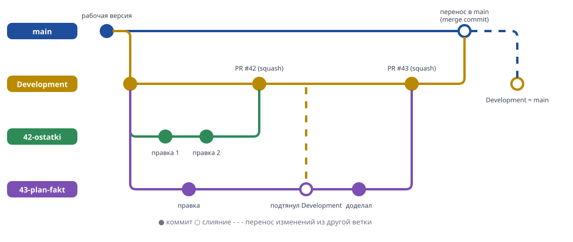
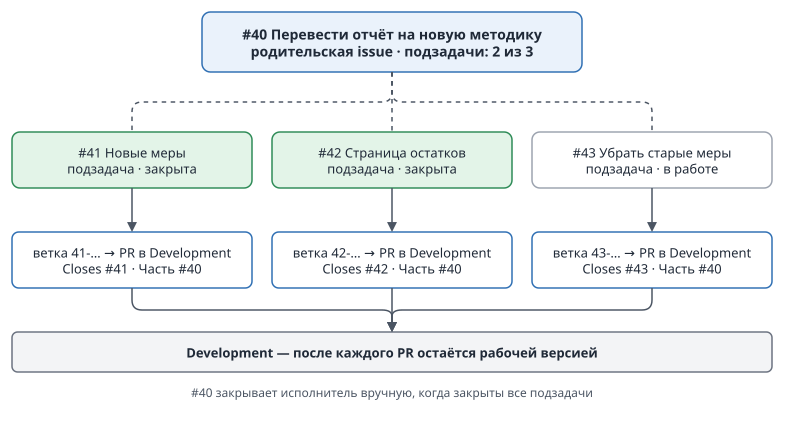
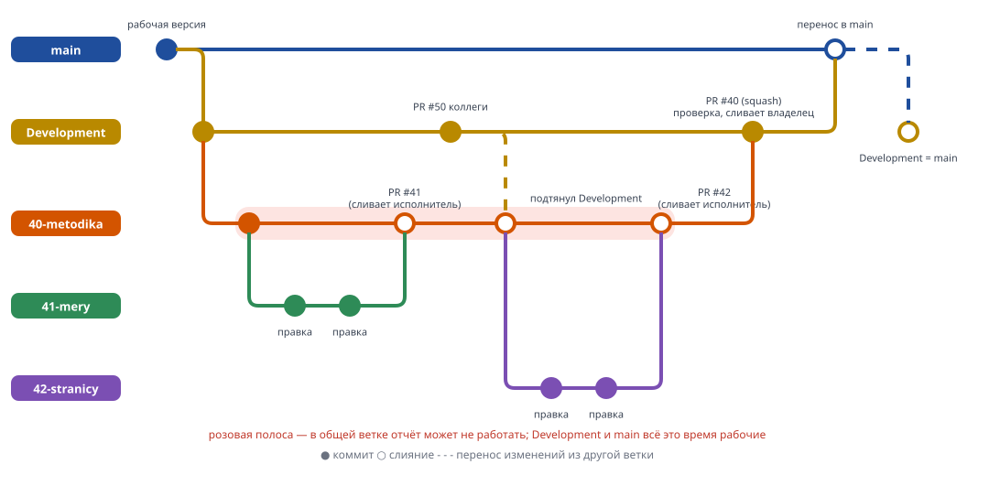
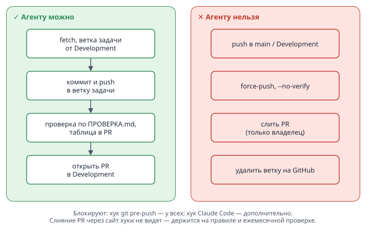

# Регламент работы с репозиториями Trest-SZMA

Действует с **2 ноября 2026 года**. Заменяет «Правила работы с репозиториями» от 01.10.2026.
Пошаговая инструкция для тех, кто только начинает, — [ПАМЯТКА.md](ПАМЯТКА.md).

Зачем: в одном репозитории работают несколько человек одновременно. Правила ниже нужны, чтобы
изменения не затирали друг друга, а в `main` всегда лежала рабочая версия.

## 1. На какие репозитории распространяется

**Общие** — где работает больше одного человека:
`SZMA-CashFlow`, `SZMA-Corporate-Economics`, `SZMA-Payroll`, `SZMA-Purchasing`, `Metal-Sales`,
`Metal-Operating-activities-02.02.000`, `Metall-Profit-And-Loss`, `Metall-Plans`, `AI_MOT`.

**AI_MOT — пока по прежнему порядку.** Ветки `Development` там нет, регламент подключается по
распоряжению владельца. До этого: работа в ветке, PR в `main`, напрямую в `main` не писать.

Репозитории, которые ведёт один человек, работают напрямую в `main`. Как только в репозитории
появляется второй участник, он становится общим и переходит под этот регламент — владелец
организации добавляет его в список выше.

## 2. Ветки

| Ветка | Что в ней | Кто пишет |
|---|---|---|
| `main` | рабочая версия, ею пользуются | только владелец, переносом из `Development` |
| `Development` | принятые задачи, ждущие переноса в `main` | только владелец, слиянием PR |
| `<№>-<кратко>` | одна задача | её исполнитель |

Как ветки живут вместе — две задачи идут параллельно, каждая входит в `Development` одним коммитом, владелец переносит накопленное в `main`:



- **Одна задача — одна ветка.** Ветка создаётся от свежего `Development` и называется по номеру
  issue: `42-ostatki-po-skladam`. Латиница, цифры и дефисы, без пробелов.
- Ветка живёт, пока идёт задача; её удаляет тот, кто сливает PR, сразу после слияния (кнопка
  **Delete branch** на странице PR). Сам PR не удаляется — он остаётся историей задачи.
  **Исключение — PR переноса в `main`:** там кнопка предложит удалить `Development`, её не нажимать.
  Автоудаление веток в настройках выключено по той же причине.
- Ветки на GitHub удаляются только кнопкой — на странице PR или в списке веток (**Branches**).
  Из терминала и VS Code удаление не пройдёт: его блокирует хук git (раздел 8).
  Свою локальную копию ветки после слияния можно удалить как обычно.
- Личные ветки (`Kuznecova`, `kudryavtsev` и т. п.) новых задач не получают. Незаконченную в них
  работу доводят до PR и закрывают.
- В `main` и `Development` **напрямую не пишет никто** — ни коммитом, ни правкой через веб-интерфейс.

## 3. Путь задачи


1. **Issue.** Задача заводится в репозитории как issue (шаблон «Задача»): что сделать, какие файлы
   затронуты. Исполнитель назначает issue на себя — так все видят, кто чем занят.
2. **Ветка** от свежего `Development`, имя по номеру issue. Если ветка создаётся со страницы issue
   (**Create a branch**), GitHub предлагает источник `main` и имя из заголовка — сменить источник на
   `Development`, имя — на латиницу.
3. **Работа.** Коммиты — сколько угодно, сообщения по-русски, по смыслу («Добавлен лист остатков»,
   а не «правки»).
4. **Обновление ветки.** Если `Development` ушёл вперёд — влить `Development` в свою ветку
   (merge). Rebase и force-push не использовать.
5. **Проверка** по `ПРОВЕРКА.md` репозитория — раздел 5.
6. **Pull request в `Development`.** Шаблон PR заполняется целиком: `Closes #42`, таблица проверки.
   Issue закроется сама, когда задача дойдёт до `main`: GitHub закрывает issue только при попадании
   в основную ветку, а текст PR входит в коммит задачи.
7. **Слияние.** Владелец просматривает PR и сливает способом **Squash and merge** — задача входит
   в `Development` одним коммитом. Автор свой PR в `Development` не сливает. Исключение — владелец: свой
   PR он сливает сам, если автоматическая проверка зелёная и таблица проверки заполнена.
8. **Перенос в `main`.** Владелец открывает PR `Development` → `main` и сливает способом
   **Create a merge commit**. Сразу после этого `Development` выравнивается по `main`, чтобы ветки
   не расходились.

Перенос в `main` — по готовности, но не реже раза в неделю, если в `Development` есть изменения.
Перед переносом владелец проверяет формально: автоматическая проверка зелёная. Задачи, вошедшие в
перенос, перечисляются в его PR строками `Closes #N` и закрываются при слиянии.

**Перенос — порядок для владельца.**

1. На кнопке слияния PR переноса выбрать **Create a merge commit**. GitHub запоминает последний
   способ, а PR задач сливаются squash'ем — поэтому способ проверяется каждый раз.
2. Кнопку **Delete branch** после слияния не нажимать.
3. Выровнять `Development` по `main` — в терминале, не через агента (хуки агента это запрещают):
   ```
   gh api -X PATCH repos/Trest-SZMA/<репо>/git/refs/heads/Development -f sha=$(gh api repos/Trest-SZMA/<репо>/commits/main --jq .sha)
   ```
   Это перемотка вперёд без перезаписи: если ветки разошлись, GitHub откажет. Вариант через git —
   `git fetch origin` и `git push --no-verify origin origin/main:refs/heads/Development`.
4. Проверить: `gh api repos/Trest-SZMA/<репо>/compare/main...Development --jq .ahead_by,.behind_by` — оба 0.

**Если перенос по ошибке слит squash'ем**, перемотка не пройдёт: содержимое веток одинаковое,
история разная. Тогда старое состояние `Development` сохраняется тегом и ветка перезаписывается по `main`:
```
gh api -X POST repos/Trest-SZMA/<репо>/git/refs -f ref=refs/tags/archive/dev-<ГГГГ-ММ-ДД> -f sha=$(gh api repos/Trest-SZMA/<репо>/commits/Development --jq .sha)
gh api -X PATCH repos/Trest-SZMA/<репо>/git/refs/heads/Development -f sha=$(gh api repos/Trest-SZMA/<репо>/commits/main --jq .sha) -F force=true
```
Перед этим убедиться, что после переноса в `Development` ничего не слили — по содержимому ветки
совпадают: `gh api repos/Trest-SZMA/<репо>/compare/main...Development --jq '.files | length'` выводит 0.
Если не 0 — не перезаписывать, а влить `main` в `Development` через PR.

### Большая задача из нескольких PR

Задачу, которую не сделать одним PR, держит **родительская issue**, а не ветка. Ветки по-прежнему
короткие — одна на часть.



**Основной способ — подзадачи.**

1. Заводится родительская issue (`#40 Перевести отчёт на новую методику`): цель и план частей.
   Ветку под неё не создают.
2. Каждая часть — подзадача: в родительской issue **Create sub-issue** (`#41`, `#42`, …).
   GitHub показывает на родителе, сколько частей закрыто.
3. Каждая подзадача проходит обычный путь задачи (шаги 1–8): своя ветка `42-…`, PR в `Development`,
   в PR — `Closes #42` и `Часть #40`.
4. **Каждый PR оставляет `Development` рабочим:** проверка по `ПРОВЕРКА.md` проходит, незаконченное
   не видно пользователю (новые меры ещё не выведены на страницы, новая страница скрыта).
   Через неделю это уйдёт в `main`.
5. `Closes #40` не пишется ни в одном PR — иначе родитель закроется с первой частью. Родительскую
   issue исполнитель закрывает сам, когда закрыты все подзадачи.

Если части так не разделить — следующий подраздел.

### Большая задача, которая ломает отчёт по ходу работы

**Когда это так.** Промежуточное состояние неизбежно ломает отчёт, и спрятать незаконченное нельзя.
Признаки — хотя бы один:

- меняется то, на чём стоят многие страницы: таблица фактов, ключи и связи модели, источник данных,
  схема расчёта, на которой держатся старые меры;
- после первой части пункты `ПРОВЕРКА.md` перестают проходить, и это не исправить без следующих частей;
- старую и новую версию нельзя держать в модели рядом (например, переименовываются столбцы,
  на которые ссылаются визуалы).

Если старое и новое могут жить рядом (новые меры рядом со старыми, новая страница скрыта) — это
обычная большая задача с подзадачами, общая ветка не нужна.

**Как работать.** Решение об общей ветке принимает владелец: исполнитель пишет в родительской issue,
что именно сломается и почему части нельзя сделать безопасными. Дальше:



1. **Общая ветка.** От свежего `Development` создаётся ветка по номеру родительской issue —
   `40-metodika`. В issue пишется: «Общая ветка: `40-metodika`».
2. **Части.** Каждая подзадача — своя ветка **от общей** (`41-mery` от `40-metodika`) и PR
   **в общую ветку**, `Часть #40`. Эти PR исполнитель сливает сам (Squash and merge) и сразу удаляет ветку части; таблица
   проверки в них не обязательна — отчёт здесь может не работать, это ожидаемо.
3. **Не отставать.** Не реже раза в неделю в общую ветку вливается свежий `Development` (merge),
   как в шаге 4. Коллеги в это время работают как обычно, и чем дольше ветка не обновлялась, тем
   больнее итоговый конфликт.
4. **Финал.** Когда отчёт в общей ветке снова целиком работает — один PR `40-metodika` →
   `Development`: `Closes #40` и `Closes` каждой подзадачи (`Closes #41`, `Closes #42`, …) —
   иначе подзадачи не закроются; полная таблица по `ПРОВЕРКА.md`. Если задача намеренно меняет
   контрольные числа — в PR пишется, какие и почему, и владелец обновляет их в `ПРОВЕРКА.md`
   вместе со слиянием. Сливает владелец, Squash and merge; общая ветка удаляется.
5. **В `main`** — обычным переносом (шаг 8).

**Ограничения.** Общая ветка — одна на родительскую issue, в `main` и `Development` из неё ничего не
попадает до финала. Ветка без активности больше 30 дней попадает в ежемесячную проверку как
заброшенная. Если работа затягивается дольше месяца — владелец с исполнителем решают, делить ли её
на этапы, каждый из которых оставляет отчёт рабочим.

## 4. Конфликты и файлы, которые git не сливает


- **Конфликт** разрешается в своей ветке: влить `Development` в ветку, разобрать конфликт, проверить,
  закоммитить. Не в `Development` и не в `main`.
- **Power BI — только PBIP.** Файлы `.pbix` в репозиториях запрещены: это архив, git не может
  слить две его версии. Модель сохраняется в Power BI Desktop как проект (Файл → Сохранить как →
  `.pbip`); текстовые файлы модели сливаются построчно.
- **Excel (`.xlsx`) — один редактор.** Две правки одной книги слить нельзя: одна из них потеряется.
  Перед правкой книги — указать её в issue («Бронь: `Отчёты/План.xlsx`») и проверить, что открытых
  issue с бронью этого файла, у которых PR ещё не слит в `Development`, нет. Бронь снимается слиянием
  PR в `Development`: issue после этого остаётся открытой до переноса в `main`, но книга уже свободна.
  На странице issue это видно по ссылке на PR со значком **Merged**.
- **Крупные файлы** больше 10 МБ в репозиторий не кладутся.

## 5. Проверка перед PR

В каждом общем репозитории есть файл `ПРОВЕРКА.md` — 5–10 пунктов основного функционала:
модель открывается и обновляется без ошибок, ключевые страницы строятся, контрольные числа за
эталонный период совпадают с записанными. Его ведёт владелец репозитория.

Перед PR в `Development` исполнитель проходит все пункты и вставляет в PR таблицу
«пункт — результат — число». **PR без таблицы не сливается.** Если пункт не проходит — исправить
до PR; если расхождение ожидаемое (задача и меняет это число) — написать в PR почему.

Если поломка всё же попала в `Development`, владелец откатывает задачу целиком (revert её коммита)
и возвращает issue исполнителю. `main` при этом не затрагивается. Если поломка уже ушла в `main`,
откат проходит обычным путём — ветка `revert-<№>`, PR в `Development` — и владелец делает
внеплановый перенос.

Исполнитель возвращает откатанную работу в **новой** ветке от свежего `Development`: откатывает
откат (`git revert <коммит отката>`), исправляет и открывает новый PR. Старую ветку не использовать.

## 6. Автоматическая проверка (CI)

На каждый PR GitHub запускает проверку `pr-check`:

- PR в `Development` — из ветки задачи; PR в `main` — только из `Development`;
- нет файлов `.pbix` и файлов больше 10 МБ;
- нет неразрешённых конфликтов (строк `<<<<<<<`, `>>>>>>>`);
- файлы модели PBIP читаются;
- в репозиториях с тестами Python проходят тесты.

**Красная проверка — PR не сливается.** Числа проверка не сверяет — это раздел 5.

## 7. Роли

**Владелец репозитория** — сейчас во всех общих репозиториях `till2718281828`. Он:
ведёт `ПРОВЕРКА.md`, сливает PR в `Development` (кроме PR частей в общую ветку большой задачи —
их сливает исполнитель, раздел 3) и переносит в `main`, раз в месяц запускает
проверку дисциплины (прямые записи, расхождение `Development` и `main`, заброшенные ветки, `.pbix`).

**Исполнитель** — заводит issue, работает в своей ветке, проходит проверку, открывает PR.

Каждый участник коммитит под своей учётной записью: `git config user.email` совпадает с почтой
в его профиле GitHub. Коммиты от `root` и чужих адресов не принимаются. Настройка — один раз на
компьютере: `git config --global user.email <адрес из GitHub → Settings → Emails>` и
`git config --global user.name "<Имя Фамилия>"`.

## 8. AI-агенты

Правила одинаковы для любого агента — Claude Code, Codex, Cursor, GitHub Copilot и других — и для
человека, который работает через агента. Агент работает по тем же правилам, что человек, и дополнительно:



- коммитит и пушит **только в ветку задачи**; push в `main` и `Development`, force-push и
  `--no-verify` запрещены;
- **не сливает PR**, не делает `reset` и `rebase` общих веток, не удаляет ветки на GitHub;
- перед началом работы делает `git fetch` и проверяет, что ветка задачи не отстала от `Development`;
- проверку по `ПРОВЕРКА.md` проходит сам (запросы к модели, тесты) и заполняет таблицу в PR;
- `.pbix` не создаёт, `.xlsx` правит только при брони в issue;
- если хук отклонил действие — не обходит его, а говорит человеку, что нужно сделать.

**Как агент узнаёт правила.** В корне каждого общего репозитория лежит `AGENTS.md` с правилами
выше — его читают Codex, Cursor, Copilot, Gemini CLI и другие агенты. Claude Code читает
`CLAUDE.md`, в нём одна строка `@AGENTS.md`. Агенту, который не читает ни того ни другого,
`AGENTS.md` передают в начале работы.

**Что блокируется технически.**

| Защита | Действует на | Что блокирует |
|---|---|---|
| хук git `.githooks/pre-push` | всех: людей и любых агентов | push в `main` и `Development`, force-push, удаление веток на GitHub |
| хук Claude Code `.claude/hooks/vetki.ps1` | Claude Code | то же, плюс `gh pr merge`, слияние через API, `--no-verify` |

Хук git включается **один раз в каждой копии репозитория**, когда в ней уже есть папка `.githooks`
(она есть в любой ветке от свежего `Development`): `git config core.hooksPath .githooks`.
Проверить: `git config core.hooksPath` выводит `.githooks`. `--no-verify` обходит хук, поэтому
запрещён; владелец пользуется им только для выравнивания `Development` по `main` (раздел 3). Слияние PR через веб-интерфейс и API хук git не видит — здесь действует
правило и ежемесячная проверка (раздел 9).

## 9. Нарушения

Раз в месяц владелец организации запускает проверку по всем репозиториям. Прямые записи в
`main` или `Development`, PR, слитые автором, и заброшенные ветки разбираются с автором.
Технически GitHub на нашем плане эти действия не запрещает — регламент держится на нас.
