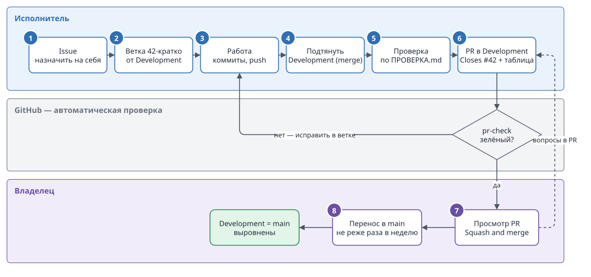
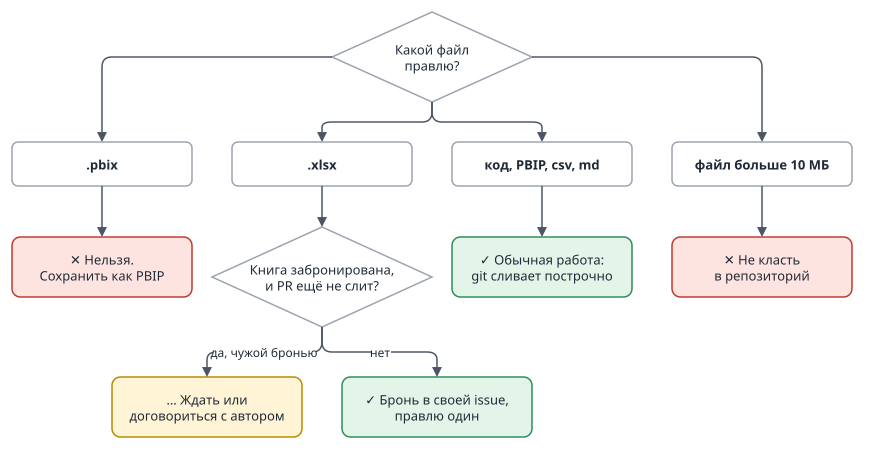
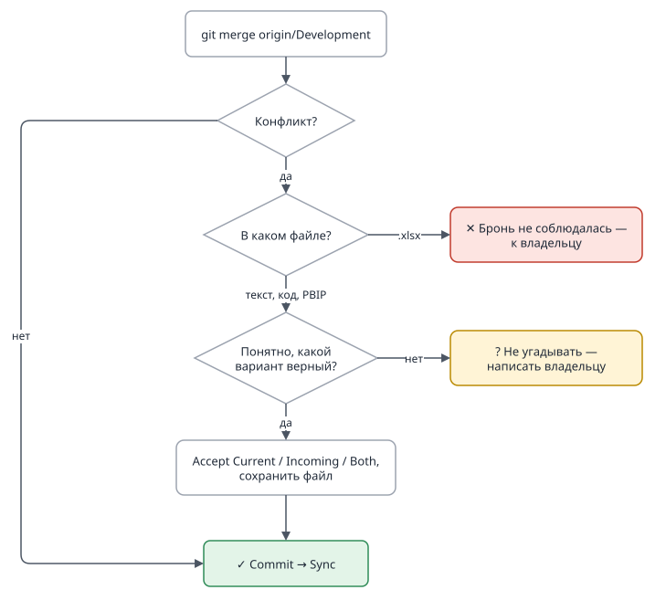

# Памятка: задача от начала до конца

Для участника общих репозиториев Trest-SZMA. Правила целиком — [CONTRIBUTING.md](CONTRIBUTING.md).
Потренироваться без риска можно в репозитории `Test`. В `AI_MOT` регламент пока не действует
(регламент, раздел 1).

Ниже каждый шаг дан двумя способами: **VS Code** (кнопки) и **терминал** (команды git).
Если работаете через AI-агента (Claude Code, Codex, Cursor, Copilot и др.) — достаточно сказать ему,
какую задачу взять: правила у него записаны (`AGENTS.md`), шаги он сделает сам и остановится перед слиянием.

**Вся задача на одной схеме** — номера совпадают с разделами ниже; шаги 7 и 8 делает владелец:



---

## 1. Завести задачу

На GitHub в репозитории: **Issues → New issue → «Задача»**. Заполнить: что сделать, какие файлы
затронуты. Если будете править Excel-книгу — впишите её в поле «Бронь .xlsx».
Справа **Assignees → assign yourself**. Запомните номер issue, например `#42`.

Перед бронью проверьте: нет ли другой issue с бронью этой книги, у которой PR ещё не слит
(поиск по Issues: имя файла; на странице issue слитый PR помечен **Merged**). Есть — договоритесь
с её автором или дождитесь слияния.



## 2. Создать ветку

**VS Code:**
1. Source Control → меню «…» → **Fetch**.
2. Внизу слева нажать на имя текущей ветки → **Create new branch from…** → выбрать `origin/Development`.
3. Имя: `42-kratko-o-zadache` (номер issue, латиница, дефисы).

**Терминал:**
```
git fetch
git switch -c 42-kratko-o-zadache --no-track origin/Development
```

**GitHub, со страницы issue:** справа **Development → Create a branch**. В окне:
- **Branch name** — GitHub подставит заголовок issue, часто кириллицей; исправить на латиницу: `42-kratko-o-zadache`;
- **Branch source** — **обязательно сменить `main` на `Development`**: GitHub по умолчанию предлагает `main`;
- **Create branch**, затем в VS Code: Fetch → имя ветки внизу слева → выбрать `origin/42-kratko-o-zadache`.

**Один раз в каждой копии репозитория** — включить защиту от push в общие ветки (терминал в папке
репозитория, на новой ветке): `git config core.hooksPath .githooks`. Проверка:
`git config core.hooksPath` выводит `.githooks`.

## 3. Работать и сохранять

Правите файлы, затем **VS Code:** Source Control → проверить список файлов → «+» у нужных →
сообщение («Добавлен лист остатков») → **Commit**. Первый раз — **Publish Branch**, дальше — **Sync**.

**Терминал:**
```
git status
git add <файлы>
git commit -m "Добавлен лист остатков"
git push -u origin 42-kratko-o-zadache
```

`git status` покажет, что попадёт в коммит: случайные `.pbix`, чужие `.xlsx` и крупные файлы не добавлять.
Коммитить можно сколько угодно раз — в `Development` всё войдёт одним коммитом.

## 4. Подтянуть свежий Development

Если коллеги за это время что-то слили, свою ветку нужно обновить.

**VS Code:** Fetch → палитра команд (Ctrl+Shift+P) → **Git: Merge Branch…** → `origin/Development`.

**Терминал:**
```
git fetch
git merge origin/Development
```

Затем снова **Sync** / `git push`.

**Не делать:** `rebase`, `push --force`, «Discard all changes» на чужих правках.

### Если вышел конфликт



Git покажет файлы с конфликтом. В VS Code в каждом — блоки «Current» (ваше) и «Incoming»
(из Development). Для каждого блока выбрать **Accept Current**, **Accept Incoming** или **Both**,
сохранить файл и нажать «+» у него, затем **Commit** и **Sync**.

Не уверены, какой вариант правильный, — не угадывайте: напишите владельцу репозитория.
Конфликт в `.xlsx` разобрать нельзя — это значит, что бронь не соблюдалась; тоже к владельцу.

## 5. Проверить

Откройте `ПРОВЕРКА.md` в корне репозитория и пройдите все пункты на своей ветке. Запишите
результат и полученные числа — они понадобятся в PR.

## 6. Открыть pull request

На GitHub появится жёлтая плашка **Compare & pull request**. Проверьте вверху:
**base: `Development`** ← compare: ваша ветка. Заполните шаблон:

- `Closes #42` — issue закроется сама, когда задача дойдёт до `main` (при переносе владельцем);
- таблица проверки — каждый пункт `ПРОВЕРКА.md`, результат, число.

**Create pull request.** Дождитесь зелёной галочки автоматической проверки. Красная — откройте
**Details**, там написано, что не так; исправьте в ветке, PR обновится сам.

## 7. Дальше — владелец

Владелец просмотрит PR, задаст вопросы в комментариях или сольёт. Сами PR не сливайте.
После слияния владелец удалит ветку на GitHub, бронь `.xlsx` снята.

Следующая задача — снова с шага 1, новая ветка. Когда вы уже на ней, старую ветку можно удалить
и у себя: **VS Code** — палитра → **Git: Delete Branch…**; **терминал** — `git branch -D 42-kratko-o-zadache`.

## 8. Перенос в main

Раз в неделю владелец переносит накопленное в `main`; тогда issue закрывается. От исполнителя ничего не нужно.

---

## Частые ситуации

| Ситуация | Что делать |
|---|---|
| Случайно закоммитил в `Development` или `main` локально | Не пушить. Написать владельцу или попросить агента: «перенеси коммит в ветку задачи». |
| Push отклонён: «ЗАБЛОКИРОВАНО регламентом» | Хук защитил общую ветку. Проверить, что вы на ветке задачи (имя внизу слева в VS Code, `git status` в терминале), и push делать оттуда. Не обходить. Непонятно — к владельцу. |
| Нужно поправить уже открытый PR | Коммит в ту же ветку и push — PR обновится. |
| Нашёл ошибку в уже слитом PR | Новая issue и новая ветка от свежего `Development`. В старую ветку не коммитить. |
| Владелец откатил мою задачу | Новая ветка от свежего `Development`, в ней `git revert <коммит отката>` (или попросить агента), исправить, новый PR. |
| Задача оказалась не нужна | Закрыть PR и issue с комментарием, ветку удалить кнопкой **Delete branch** на странице PR. |
| Задача большая, за один PR не сделать | Завести родительскую issue, части — подзадачами (**Create sub-issue**). Каждая часть — своя ветка и PR в `Development` с `Closes #<часть>` и `Часть #<родитель>`. Родителя закрыть самому в конце. Подробнее — регламент, раздел 3. |
| Большая задача, и по ходу отчёт неизбежно сломается | Не сливать части в `Development`. Согласовать с владельцем общую ветку `<№ родителя>-<кратко>`, части делать от неё и сливать в неё самому, раз в неделю подтягивать `Development`. В конце — один PR в `Development` с полной проверкой и `Closes` родителя и всех частей. Регламент, раздел 3. |
| У меня старая личная ветка с работой | Довести до PR в `Development` или удалить на GitHub (**Branches** → корзина), если работа не нужна. Новые задачи — только в новых ветках. |
| Проверка ругается на `.pbix` | Сохранить модель как PBIP (Файл → Сохранить как → .pbip), `.pbix` убрать из ветки. |
| Коммиты подписаны не мной | Один раз: `git config --global user.email <адрес из GitHub → Settings → Emails>` и `git config --global user.name "<Имя Фамилия>"`. |
